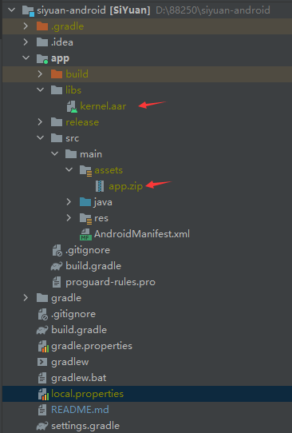
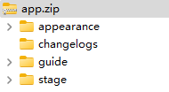

# SiYuan-Android-Fork

思源筆記安卓端修改, 使其支援自定工作區文件夾

此倉庫包含 release 下載, 源碼以及自構建指南, 只是自用心血來潮改一下, 擔心安全請使用原版

---

## Release 使用

1. 下載安裝 https://github.com/qimuan7/SiYuan-Android-Fork/releases/download/3.8.8-fork/siyuan-3.8.8-al4-fork-official-release.apk

2. 初次開啓會有以下畫面, 點擊獲取所有文件訪問權
> 因爲 SAF 太麻煩, 要改虛擬路徑映射, 所有文件訪問權沒這個問題, 但也只會讀取所選的用戶目錄

3. 選擇創建或開啓已有工作區, 選擇創建: 選到你希望思源筆記放料的目錄, 最後一個文件夾名會變成工作區名 ; 選擇開啓: 選擇直到看見思源生成的資料(看見conf, data, temp)爲止, 工作區名字跟最後一個文件夾名

4. (如果)在工作區左上角開啓: 設定選單 > 工作空間 > 裏面的"新建"會在當前工作區的同目錄下創建另一個跟你輸入名字一致的文件夾, 並在裏面放資料 ;  "打開"則會找同目錄下是否有其他工作區, 在跳出選單中列出

5. 剩下跟思源安卓端理論上一致, 但不會自動更新, 因爲包名(applicationid)爲了避免和原版衝突所以改了, 但不建議和原版一起裝, 可能導致 127.0.0.1:6808 端口被佔用, 總要閃退一個

6. 大概不怎麼會有更新, 需要可以看下面的步驟自己改一個, 如果你願意 :)

---

## 構建:

**源碼因爲附件大小有一部份沒傳上倉庫, 到底哪些有哪些沒我也不知道, 在 release 裏我上傳完整的 zip 以及步驟文件, 怕有危險也能聽個思路自己下原版來改**

---

### 一. 內核:

這是更改首要, siyuan-kernel 在思源主倉庫 siyuan-matser/kernel, 使用 Go 語言, 核心思路是把移動端固定的目錄改爲可變的數值, 把移動端的配置文件home目錄(對應win的user/.config/siyuan/)改到應用目錄(也可以不改)

#### 1.1 HomeDir:

workspaceBaseDir/home (原來在工作區下) >> 改爲 >> filepath.Dir(appDir) + "/home" (應用目錄android/data/包名 裏)

#### 1.2 initWorkspaceDirMobile:

defaultWorkspaceDir := filepath.Join(workspaceBaseDir, "siyuan") (默認至應用目錄) >> 改爲 >> := workspaceBaseDir 自定指定目錄 (需要前端配合)

(這一堆其實可以拿 IDE 打開 kernel 目錄, 然後全文搜索就可以找到內文, 對應上述兩點改就好)

---

印象裏就只改了 kernel/mobile/kernel.go 和 kernel/util/working_mobile.go, 你可以直接在 release 下載 SiYuan-Kernel.zip 即我改過的兩個文件放進內核, 然後自行編譯

記得下載 Go 語言環境, 下載後 cd 到目錄運行

1. go get -tool golang.org/x/mobile/cmd/gobind

2. gomobile bind --tags fts5 -ldflags "-s -w" -v -o kernel.aar -target="android/arm,android/arm64" ./mobile/

編譯得到 kernel.aar 就 ok (生成在kernel根目錄)

---

### 二. 不想編譯?

release 裏有我預先編譯好的 kernel.aar 以及所需的 app.zip (來自官方siyuan-3.8.7.apk解壓, 不信我可以自己在 release 下這個 apk自己解壓)

解壓完以後你需要有一份 SiYuan-Android 的源碼, 在這裏下載: https://github.com/siyuan-note/siyuan-android

---

### 三. 編譯或快速編譯:

編譯前你需要: kernel.aar, app.zip, siyuan-android 源碼, 一些源碼前端修改

快速自編譯可以下 release 裏的 SiYuan-Andoird-Fork_v3.8.8-arm_Source.zip 然後直接按編譯, 非常快 :)

自己改的話:

1. app.zip 放到你的源碼中的 SiYuan-android/app/src/main/assets

2. kernel.aar 放到你的源碼中的 SiYuan-android/app/libs

3. 你需要寫一個類似我 welcomeactivity 的前端來告訴內核, 你的工作目錄要放哪, 同時需要獲取 android 文件權限, 建議用所有文件訪問權, SAF 權限要解釋虛擬路徑稍微(很)麻煩, 如果有能力還可以改改 css 和 js , 也就是工作區的主界面, 我研究了半天沒改明白

4. 不保證沒有 bug, 但我覺得我大概不會怎麼更新, 因爲在嘗試研究 Obsidian 和插件...(當然思源也很好用只是我偏向文字, 思源的同步和載入速度沒那麼及預期)

5. 萬事可以嘗試問 AI (AI 太好用了朋友們.jpg)

---

願你今日開心 :33.
剩下的 ui 可以自己寫, 也可以把倉庫裏的 App.java ; BootActivity.java ; JSAndroid.java ; MainActivity.java ; WelcomeActivity.java 作爲參考
